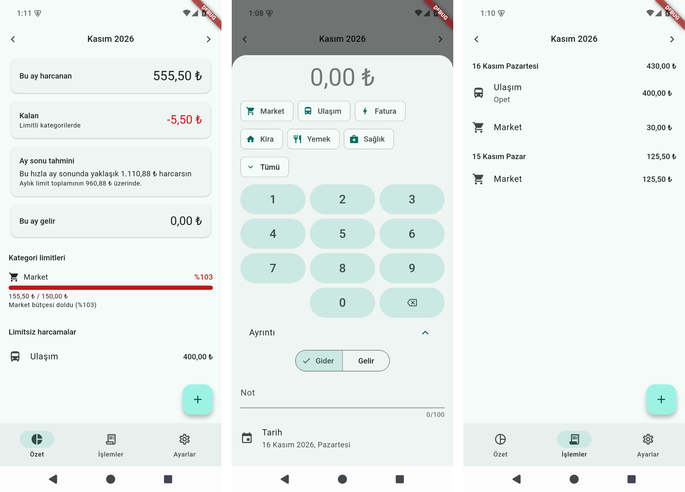

# Bütçe Takip

Android için hesapsız, yerel gelir-gider takibi. Arayüz Türkçe, para birimi TL.

**Hesap yok, veri yalnız telefonunda.** Güncelleme denetimi için, ve yalnız sen açarsan GitHub'a bağlanır; verilerin telefondan çıkmaz. Tek istisna aşağıdaki Ziraat notu: döküm içeriği yine gönderilmez, ama Google ML Kit kendi kullanım ölçümünü gönderebilir.

Not (Ziraat dökümü): Ziraat PDF'i resimdir, bu yüzden telefonda Google ML Kit ile okunur (model uygulamanın içinde, dökümün içeriği telefondan çıkmaz). Google'ın veri açıklamasına göre ML Kit, tanıma sırasında cihaz/uygulama bilgisi, gecikme gibi performans ölçümleri ve hata kodlarını Google'a gönderebilir (HTTPS); açıklamada resim içeriği yer almaz, kapatma yolu belirtilmemiştir (kaynak: developers.google.com/ml-kit/android-data-disclosure). Yapı Kredi dökümünde ML Kit hiç çalışmaz.

> Plan ve kararlar: [PLAN.md](PLAN.md). Güvenlik incelemeleri: [guvenlik/incelemeler](guvenlik/incelemeler).



## Özellikler

- Gelir ve gider ekleme, düzenleme, silme (silmede "Geri al"). Hızlı giriş: tuş takımı açık gelir, en sık kullanılan kategoriler çip olarak altta.
- 10 hazır kategori; yenisi eklenir, yeniden adlandırılır, arşivlenir ya da silinir (silince işlemleri Diğer / Diğer gelir'e taşınır).
- Kategori başına aylık limit ve ilerleme çubuğu.
- Toplam bakiye: tüm gelir eksi tüm gider, başlangıç bakiyesiyle; karta dokunup bankadaki bakiyeye eşitlenir (işlem eklenmez).
- Hesap dökümü içe aktarma (Yapı Kredi PDF; Ziraat Bankası resimli PDF, OCR ile): Ayarlar'dan ya da Android "Paylaş" ile; önizlemede kategori seçilir, zaten kayıtlı ve kendi hesaplar arası satırlar işaretsiz gelir.
- Özet: bu ay harcanan, kalan ve ay sonu tahmini.
- Cihaz içinde, kural tabanlı öneriler: nottan kategori önerisi, tekrarlayan gider önerisi, bütçe aşım bildirimi (limitin %80 ve %100'ünde).
- JSON yedek: dosyaya kaydet ya da paylaş, geri yükle.
- Verileri sıfırla (Ayarlar): yalnız işlemleri sil ya da her şeyi ilk kurulum haline döndür; önce veritabanının kopyası alınır.

## Kurulum

GitHub Releases sayfasından en son `Butce-Takip-<sürüm>.apk` dosyasını indirip telefona kur
(bilinmeyen kaynaklardan yüklemeye izin gerekir). Sonraki sürümler veri kaybı olmadan üstüne kurulur.

## Yedek uyarısı

Veri tek kopya: yalnız telefondadır. Uygulamayı kaldırmak ya da telefonu sıfırlamak veriyi siler
(Android otomatik yedeği kapalıdır). Ayarlar'dan düzenli olarak JSON yedeği al ve telefon dışına kopyala.

## Doğrulama

Sertifika SHA-256 parmak izi: `2C:0A:94:60:13:5E:42:07:81:18:E4:BA:64:13:72:6D:FE:5B:85:B5:75:B0:2E:EA:20:71:F2:3C:B8:BA:8E:B1`

## Geliştirme

```
flutter pub get
flutter analyze
flutter test test/x_test.dart    # dosya dosya, aşağıdaki nota bak
```

Yerel yayın derlemesi (NDK'sı olmayan makinede): `BUTCE_YEREL_NDKSIZ=1 flutter build apk --release`.
Bu APK debug anahtarıyla imzalanır ve büyüktür; yalnız derleme denemesidir. Yayın APK'sı GitHub
Actions'ta (`release.yml`) sürüm anahtarıyla derlenir. Sürüm yayımlama sırası ve güvenlik kapısı:
[guvenlik/incelemeler/README.md](guvenlik/incelemeler/README.md).

### Test notu: flutter_tester çökmesi (ortam kaynaklı)

Bu makinede `flutter test` süreci (`flutter_tester.exe`) projeden bağımsız, rastgele çöker (0xC0000005):
"Connection closed before test suite loaded" ya da testlerin topluca "did not complete".

- Çökme saf Dart test dosyasında da oluyor.
- Windows hata raporlarında (WER) kayıtlar 2026-11-03'ten beri var; yani proje başlamadan önce de çöküyordu.
- Test koduyla ilgisi yok: çökmeyen koşuda testler yeşil geçer.

Testleri dosya dosya çalıştırın (`flutter test test/x_test.dart`). Yalnız çökme belirtisiyle biten dosyayı yeniden deneyin;
`Expected/Actual` ya da istisna içeren hata gerçektir, yeniden denemeyle geçmez.

## Lisans

[MIT](LICENSE)
